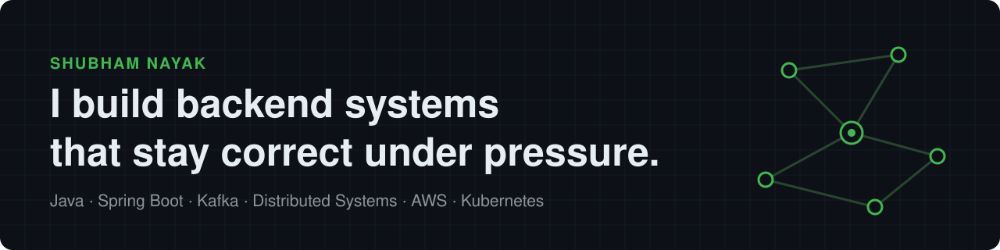
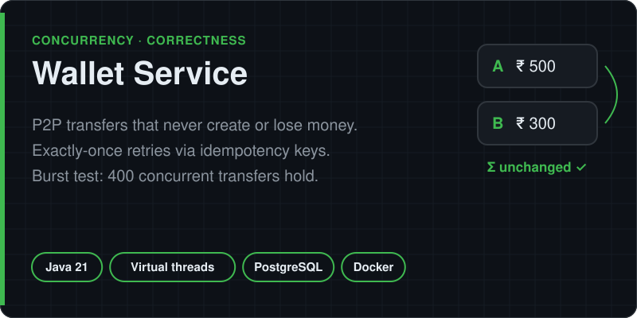
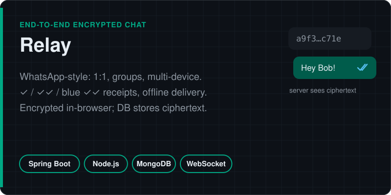
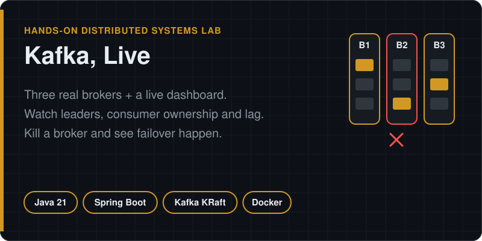
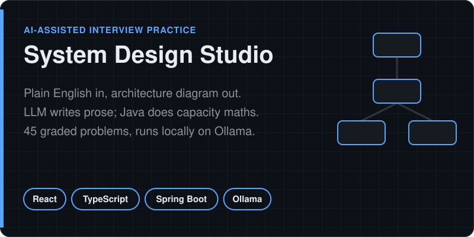
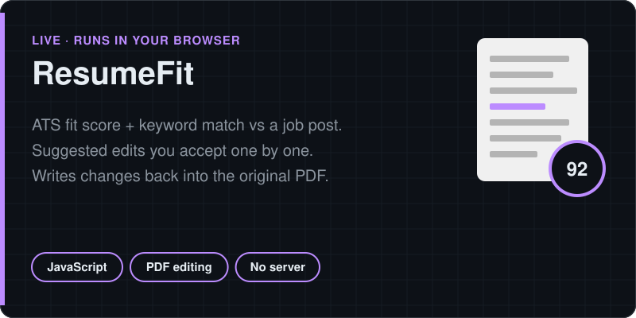
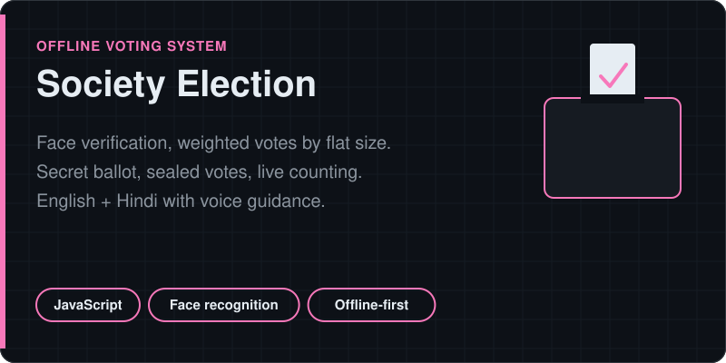
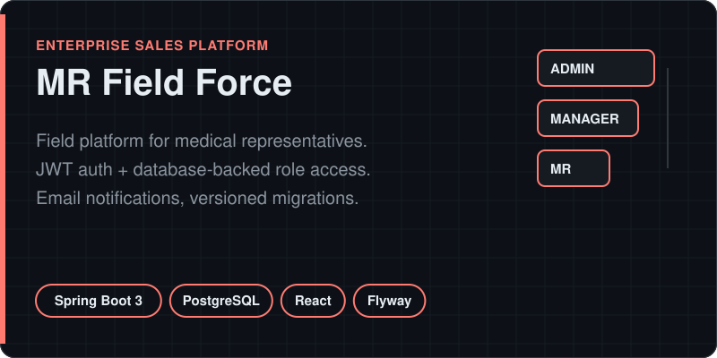
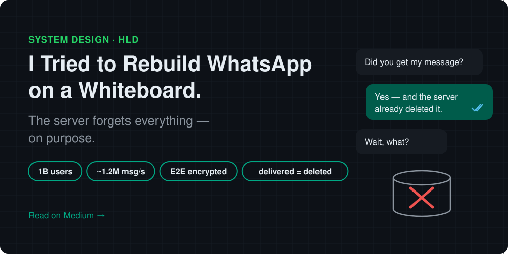

I build backend systems that stay correct under pressure — concurrent money movement,
event-driven pipelines, encrypted messaging. Most of my work lives in Java and Spring Boot,
talking over Kafka, deployed with Docker, AWS and Kubernetes.

I like projects you can *prove*: a script that fires hundreds of concurrent transfers and checks
no money was created, a Kafka lab where you kill a broker and watch leadership move.

Currently going deep on **Distributed Systems**, **High-Level Design** and **Low-Level Design**.

---

### Featured work

<table>
  <tr>
    <td width="50%"></td>
    <td width="50%"></td>
  </tr>
  <tr>
    <td width="50%"></td>
    <td width="50%"></td>
  </tr>
  <tr>
    <td width="50%"></td>
    <td width="50%"></td>
  </tr>
  <tr>
    <td width="50%"></td>
    <td width="50%" valign="top">
      <b>More projects</b>  
      <a href="https://github.com/Ner04/Indian-forest-project">Indian Forests</a> — interactive atlas of India's forests and wildlife · React + TypeScript  
      <a href="https://github.com/Ner04/Friend-Book-AI-social-media-project-">Friend-Book</a> — social platform as microservices with API gateway + Eureka · Spring Boot  
      <a href="https://github.com/Ner04/LLD-">LLD</a> — low-level design problems in Java  
      <a href="https://github.com/Ner04/Java_DSA">Java DSA</a> — Java from basics through algorithms and interview prep  
      <a href="https://github.com/Ner04/resume-editor-">ResumeFit source code</a>
    </td>
  </tr>
</table>

---

### Latest writing

**[I Tried to Rebuild WhatsApp on a Whiteboard. The Server Forgets Everything — On Purpose.](https://medium.com/@shubhamnayak0904/i-tried-to-rebuild-whatsapp-on-a-whiteboard-the-server-forgets-everything-on-purpose-830946c1d798)**
A high-level design walkthrough of a 1-billion-user chat app — ticks, multi-device, sharding, calls.

**More posts**

| Post | Published |
| --- | --- |
| [The Double Charge Bug: Why Every Payment API Needs Idempotency](https://medium.com/@shubhamnayak0904/the-double-charge-bug-why-every-payment-api-needs-idempotency-cbec2ac1721d) | Nov 2026 |
| [Netflix Is a Pizza Shop That Never Makes You Wait (So I Built One in Java)](https://medium.com/@shubhamnayak0904/netflix-is-a-pizza-shop-that-never-makes-you-wait-so-i-built-one-in-java-68eafb67f417) | Oct 2026 |
| [I Built Zomato in 400 Lines of Java (And Learned Why Your Biryani Never Gets Delivered Twice)](https://medium.com/@shubhamnayak0904/i-built-zomato-in-400-lines-of-java-and-learned-why-your-biryani-never-gets-delivered-twice-447fbab9bfd7) | Oct 2026 |
| [ACID vs BASE: The Interview Cheat Sheet You'll Actually Remember](https://medium.com/@shubhamnayak0904/acid-vs-base-the-interview-cheat-sheet-youll-actually-remember-731bcb8cfb86) | Oct 2026 |
| [Designing a Booking System That Never Double-Books](https://medium.com/@shubhamnayak0904/designing-a-booking-system-that-never-double-books-e4bb8c9884f0) | Oct 2026 |
| [Designing a URL Shortener: From Short Codes to Scale](https://medium.com/@shubhamnayak0904/designing-a-url-shortener-from-short-codes-to-scale-77e2cbc82905) | Sep 2026 |

[All posts on Medium →](https://medium.com/@shubhamnayak0904)

---

### Stack

**Languages**

**Backend & data**

**Infrastructure**

**Front end**

---

📫 [shubhamnayak0904@gmail.com](mailto:shubhamnayak0904@gmail.com)
